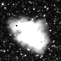
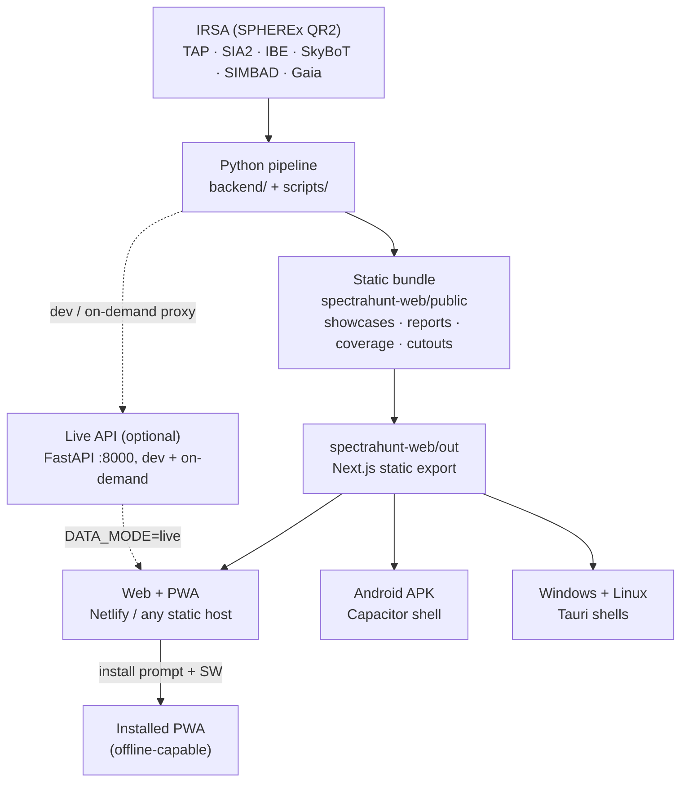
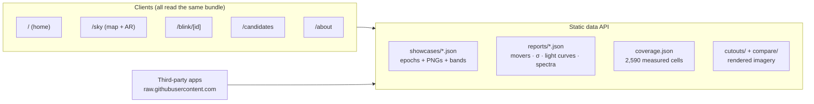
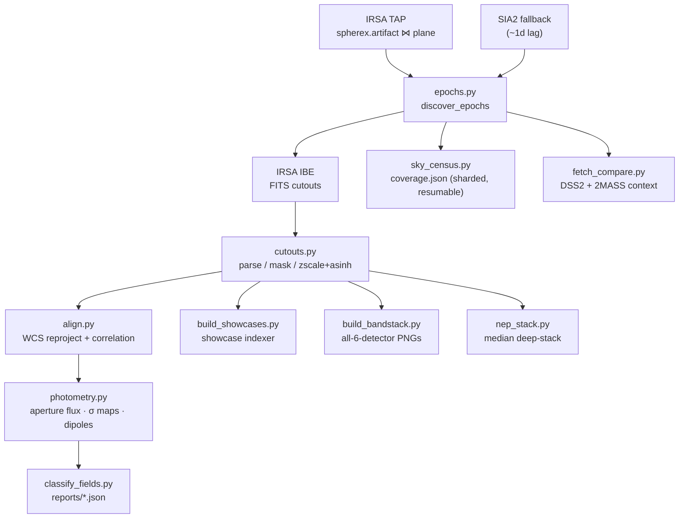

# DRISHTI

**DRISHTI: Dynamic Repository for Infrared Spectral History and Transient Inspection**

**NASA Space Apps Challenge 2026 · Advanced · Astrophysics / Planets & Moons / Software · built by team AKASHTORI**

> Since 2025, NASA's SPHEREx mission maps the entire sky every six months in 102 bands
> of near-infrared light. Comets, asteroids, stars, brown dwarfs — and maybe new planets —
> reveal themselves by shifting between visits. No one person can sift a billion objects alone.
> DRISHTI is the public front door: search any object or sky position, then blink
> between SPHEREx epochs to see what changed.

**Live rule:** every pixel, number, and field traces to IRSA data or a local cache of it.
Nothing is fabricated — unmeasured sky renders dark and says so. See § Data rules.



*Real SPHEREx cutout served by the app (Crab field, detector D3).*

## Contents

- [What it is](#what-it-is)
- [Architecture](#architecture)
- [Features](#features)
- [Data pipeline](#data-pipeline)
- [Data rules](#data-rules)
- [How deep the data goes](#how-deep-the-data-goes)
- [The data (reuse it)](#the-data-reuse-it)
- [Quick start](#quick-start)
- [Mobile and desktop](#mobile-and-desktop)
- [Repository map](#repository-map)
- [Checks](#checks)
- [Citation](#citation)

## What it is

DRISHTI turns SPHEREx Quick Release 2 (QR2) — the all-sky near-infrared survey —
into something a human can explore in three clicks: **Home → field → drag the blink
slider**. Underneath, a Python pipeline discovers repeat visits (epochs) at any sky
position via IRSA, renders cutouts, aligns them, measures movers/variables with
aperture photometry, and cross-matches known objects. The web app blinks epochs,
draws light curves and 6-band mini-spectra, and exports figures.

Today's bundle: **20 fields · 143 epochs · 240 cutouts · 20 measurement reports
(growing) · 2,590-cell measured sky census.**

## Architecture

One source builds every client. `spectrahunt-web/out` (Next.js static export) is the
only web artifact — the website, the PWA, the Android shell, and the desktop shells
all serve that exact directory. No per-platform code forks.





## Features

| View | Route | Job |
|---|---|---|
| Home | `/` | Yale-BSC star map over 2MASS (clickable mini-map), object/coordinate search, Try chips + dice, field rail, numbers band, how-it-works |
| SkyMap | `/sky` | One-row observer island (Alt/Az readout, location presets + GPS, manual clock, display drawer) over real HiPS sky with Gaia stars, figures, grid; **Point-at-sky AR** (vector-arrow button) drives the camera from compass + tilt; all-sky coverage toggle; hover readout, inspector with blink entry |
| Blink | `/blink/<id>` (live: `/blink/live?ra=&dec=&band=`) | Square stage + control column (View/Display/Bands/Measure); autoplay transport, timeline + filmstrip, blink/side/swipe/diff/replay/exclusive motion-color/false-color, stretch + colormaps, 102 channels, in-browser ±5σ detection, click spectrum, PNG/WebM/figure export, ⌘K palette. Failed frames auto-retry with a Retry button — never a forever spinner |
| Featured | `/candidates` | Full-bleed liquid-glass cards (rotating grayscale/viridis/cividis thumbs), objects modal, filters with frosted count badges, CSV/JSON export |
| About | `/about` | Team AKASHTORI photocards with contact links |
| Mission | `/mission` | LVF same-band rule, band table, tours, glossary, shortcuts, method, citation |
| Orbital intro | `/intro` | Cinematic BORESIGHT sequence: live SPHEREx orbit (real TLE), procedural spacecraft model, glitch transition to console home |

Three clicks to first blink. Works offline once visited (service worker); works on a phone.

## Data pipeline



Key scripts (`scripts/`): `sky_census.py --shard I/N --progress f` + `--merge` (all-sky census),
`build_showcases.py --only <id>` (oldest+newest pairing, ≤5 sibling frames for IBE 422s),
`build_bandstack.py`, `classify_fields.py --only/--force` (skips fresh reports),
`nep_stack.py --n 12`, `process_field.py --ra --dec --band` (ad-hoc field),
`warm_cache.py`, `nightly.sh` (merge → fill → build → verify → commit),
`release.py` (one source builds web + APK + desktop, collects `dist/`).

Backend (`backend/`, FastAPI): `/health /api/showcases /api/showcase/{id} /api/epochs
/api/cutout.png /api/frame.png /api/frames /api/resolve /api/skybot /api/stars
/api/detect /api/lightcurve /api/spectrum /api/citation` — read-only IRSA proxy with
SQLite TTL caches; never 500s on expected paths. Full reference: `docs/API.md`.

## Data rules

- **Source:** SPHEREx QR2 via IRSA (DOI `10.26131/IRSA652`). TAP first (no lag),
  SIA2 fallback, IBE cutouts `?center=RA,Dec&size=deg`.
- **LVF rule:** one pixel sees different wavelengths per pointing — we blink
  **same-band epochs only** (|Δλ| < ½ bandwidth), enforced at index time.
- **Cross-match:** SkyBoT cone at exposure MJD (cached 30 d), MPC checker,
  Sesame/SIMBAD, Horizons on demand. Never blocks the blink.
- **Honesty:** `png:null` renders metadata + "cutout pending"; unmeasured sky renders
  dark; unknown fields say "not yet surveyed". Nothing is fabricated.

## How deep the data goes

One survey is never the whole story. Every layer below is live in the
app today, and every number on screen names which one it came from:

| Layer | Source | Where it surfaces |
|---|---|---|
| Infrared epochs | **SPHEREx QR2, NASA/IPAC IRSA** (TAP, SIA2, IBE; DOI `10.26131/IRSA652`) | every cutout pixel, epoch count, MJD, band |
| Sky context | **CDS Strasbourg** HiPS (DSS2 + 2MASS), hips2fits | base imagery, all-sky map |
| Stars | **ESA Gaia DR3** | cross-matches, observer overlays, G magnitudes |
| Names | **SIMBAD / Sesame** (CDS) | typed-query resolution |
| Movers | **IMCCE SkyBoT**, MPC, **JPL Horizons** | solar-system cross-checks at exposure MJD |
| Orbits | **CelesTrak** TLEs | live SPHEREx orbit in the intro |
| Bright stars | **Yale Bright Star Catalog v5** (vendored) | 1,627-star home sky-map layer |
| Figures | Standard constellation lines (vendored GeoJSON) | 89 asterism figures |
| Nebulae | Messier/NGC catalog positions | glow placement (rendering artistic, positions real) |

## The data (reuse it)

Every measured artifact is a plain file in this repo — any third party can fetch it
into their own app today via `raw.githubusercontent.com` (or a clone). No server,
no key, no permission needed.

- `spectrahunt-web/public/showcases/*.json` — fields: coords, story, epochs
  (labels, MJD, band, PNG, provenance URLs), per-detector band PNGs
- `spectrahunt-web/public/reports/*.json` — measurements: movers, variables,
  top σ, baselines, **light curves**, **6-band spectra with errors**, known-object
  cross-matches with citations
- `spectrahunt-web/public/coverage.json` — 2,590 measured sky cells
- `spectrahunt-web/public/cutouts/` + `compare/` — rendered PNGs (≤100 KB) and
  DSS2/2MASS context JPGs

Weekly-snapshot cadence (see `.github/workflows/refresh.yml`); pin a commit hash
for reproducibility; cite SPHEREx/IRSA (DOI above) plus this repo (MIT).

## Quick start

```bash
make up        # API :8000 + web :3000 (live mode) — clone-to-running
make warm      # front-load slow IRSA queries into the cache
make check     # pytest + vitest + tsc + eslint + web build
make web       # static export -> spectrahunt-web/out
make down      # stop local servers
```

Manual equivalent:

```bash
cd spectrahunt-web && npm install && npm run dev   # http://localhost:3000
```

Live dev API (real-time TAP/IBE proxy instead of the static bundle):

```bash
pip install -r requirements.txt
python -m backend                                  # :8000/health
cd spectrahunt-web
NEXT_PUBLIC_DATA_MODE=live NEXT_PUBLIC_API_URL=http://localhost:8000 npm run dev
```

Fill showcase pixels (weekly/manual, bounded, resumable, offline-safe):

```bash
python scripts/sky_census.py --shard 0/4 --progress data/census_shard_0.json &
python scripts/build_showcases.py --only 3i-atlas
python scripts/classify_fields.py
cd spectrahunt-web && npm run build
```

Docs for collaborators: `SYSTEM_DESIGN.md` (design), `ARCHITECTURE.md` (contracts),
`CONTRIBUTING.md` (workflow), `docs/API.md` (endpoints), `docs/FRONTEND.md` (routes/state),
`docs/PIPELINE.md` (modules/ops), `docs/TROUBLESHOOTING.md`, `DEMO.md` (90-s script).

## Mobile and desktop

Same `out/`, four shells — release with `python scripts/release.py [--version X.Y.Z]`
(web + APK + desktop bundles collected into `dist/`), or tag `v*` for the
`.github/workflows/release.yml` CI. Fully local ship possible: signed APK
(release keystore), Linux `.deb`, manual `appimagetool` AppImage, and even
Windows NSIS via `cargo-xwin` + home-built `makensis` — see TROUBLESHOOTING.

| Shell | Tech | Notes |
|---|---|---|
| PWA | manifest + `sw.js` + install chip | Offline after first visit; installable from the browser |
| Android | Capacitor (`org.drishti.app.offline`) | Bundled `out/` = fully offline; `_blank` links → system browser; hardware back walks history. Build: `npx cap sync android` + gradle (JDK 21) |
| Windows / Linux | Tauri v2 (`org.drishti.app`) | Targets: `nsis`, `appimage`, `deb`; external links via opener plugin. Linux builds locally; Windows via CI |
| Point-at-sky | `StellariumView` + `lib/skyposture.ts` | Device compass + tilt + GPS + clock → live RA/Dec camera with heading/elevation HUD, figure-8 calibration hint, ±45° compass trim, pause-on-drag. Round-trip-tested (100+ cases) |

## Repository map

```
backend/            # FastAPI: discovery, cutouts, detect, lightcurve, spectrum, cross-match
scripts/            # census, indexers, bandstack, NEP stack, classifier, nightly, release, icons
desktop/src-tauri/  # Tauri shell (Windows nsis, Linux appimage/deb)
spectrahunt-web/
  android/          # Capacitor shell (offline APK)
  public/showcases/ # 20 fields (real coords/epochs, PNG via indexer)
  public/cutouts/   # rendered PNGs, ≤100KB, immutable cache
  public/compare/   # DSS2 + 2MASS context JPGs per field
  public/reports/   # measured classifications per field (movers/σ/curves/spectra)
  public/coverage.json # measured cells {epochs, images, bands, span}
  public/icons/ sw.js  # PWA install + offline
  src/lib/astro.ts  # coordinates, 88 constellations, 102 channels, stretch/colormaps
  src/lib/skyposture.ts # point-at-sky math (sensors -> RA/Dec)
  src/              # pages + viewers (HeroSky, StellariumView, Blink deck, rail) + store
data/               # git-ignored scratch (SQLite cache, census shards)
dist/               # git-ignored release artifacts (APK, AppImage, installers)
```

## Checks

```bash
.venv/bin/python -m pytest backend/tests/ -q   # 18 collected
cd spectrahunt-web && npm test                 # 58 passed (vitest)
cd spectrahunt-web && npx tsc --noEmit && npx eslint src  # 0 errors
cd spectrahunt-web && npm run build            # static export to out/
```

Bundle budget <10 MB (PNG+JSON). Weekly refresh via `.github/workflows/refresh.yml`.

## Citation

> This publication makes use of data products from SPHEREx (JPL/Caltech, NASA),
> processed by IRSA (IPAC). DOI `10.26131/IRSA652`.

License: MIT + required SPHEREx/IRSA attribution (see `LICENSE`).
