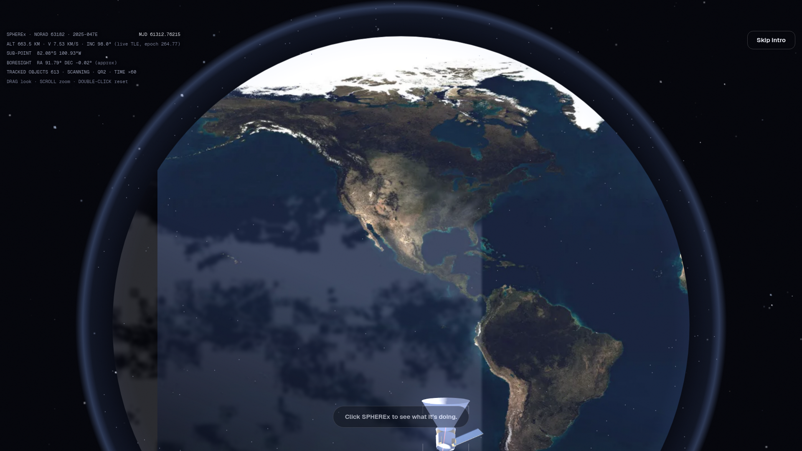
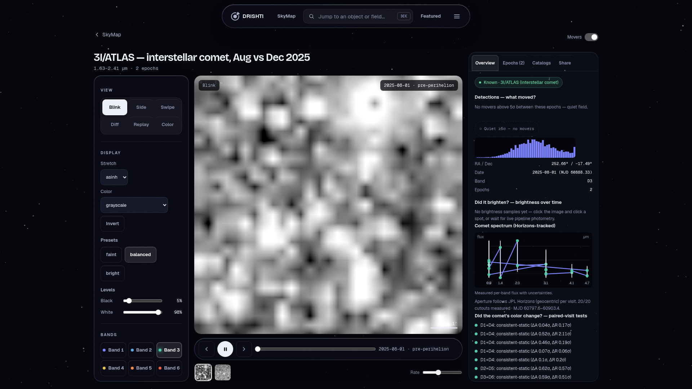
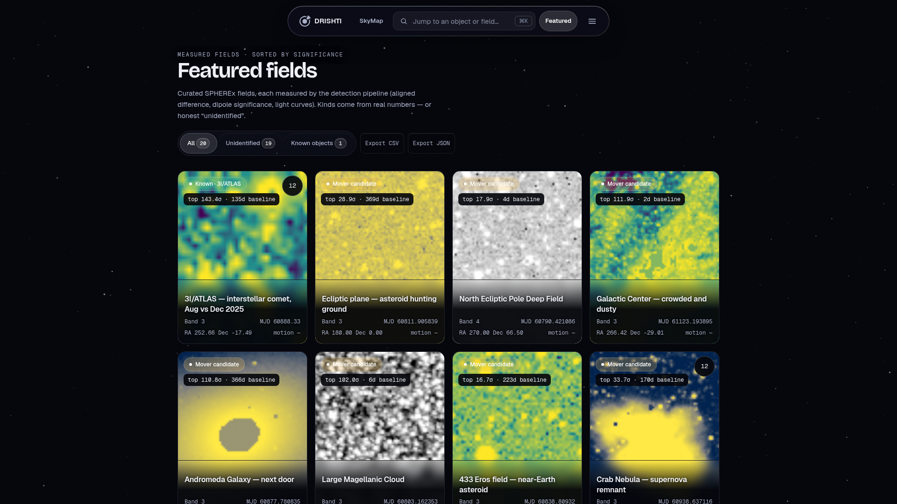
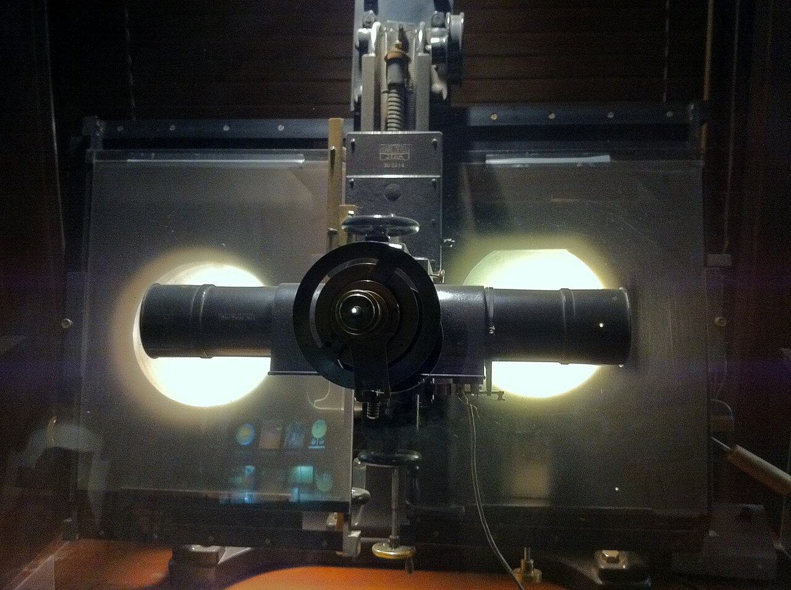
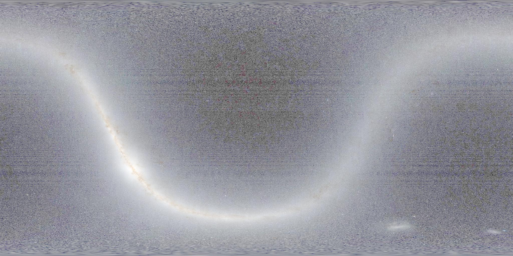

<div align="center">


### Dynamic Repository for Infrared Spectral History and Transient Inspection

**NASA Space Apps Challenge 2026 · Advanced · Astrophysics / Planets & Moons / Software**
Built by **team AKASHTORI**.


<br>

<a href="#overview">Overview</a> · <a href="#gallery">Gallery</a> · <a href="#features">Features</a> · <a href="#how-it-works">How it works</a> · <a href="#quick-start">Quick start</a> · <a href="docs/README.md">Documentation</a>

</div>



> **Live rule.** Every pixel, number and field traces to IRSA data or a local cache of it. Nothing is fabricated — unmeasured sky renders dark and says so.

---

## Overview

Since 2025, NASA's **SPHEREx** mission has mapped the entire sky every six months in 102 bands of near-infrared light. Comets, asteroids, stars, brown dwarfs — and maybe new planets — reveal themselves by *shifting between visits*. No one person can sift a billion objects alone.

**DRISHTI is the public front door.** Search any object or sky position, then blink between SPHEREx epochs to see what changed. Underneath, a Python pipeline discovers repeat visits via IRSA, renders cutouts, aligns them, measures movers and variables with aperture photometry, and cross-matches known objects. The web app blinks epochs, draws light curves and 6-band mini-spectra, and exports figures.

Today's bundle: **20 fields · 143 epochs · 240 cutouts · 20 measurement reports (growing) · 2,590-cell measured sky census.**

### Three clicks to first blink

| | Step | What happens |
| --- | --- | --- |
|  | **1 — Search** | Type a name, coordinates or constellation on the home sky map. |
|  | **2 — Pick a field** | Click a marker or a surveyed sky cell to open its inspector. |
|  | **3 — Blink** | Drag the timeline slider. Same sky, different time — motion jumps out. |

Works offline after the first visit, and works on a phone.

---

## Gallery

Real captures of the shipped app. No mock-ups, no generated science imagery.

<table>
<tr>
<td align="center" width="33%">
<b>Home</b><br>
<br>
<sub>Clickable sky map, object search, coverage toggle.</sub>
</td>
<td align="center" width="33%">
<b>Blink</b><br>
<br>
<sub>Real SPHEREx cutouts of 3I/ATLAS across two visits.</sub>
</td>
<td align="center" width="33%">
<b>Candidates</b><br>
<br>
<sub>Measured classifications — never invented.</sub>
</td>
</tr>
</table>

<details>
<summary><b>More real views</b></summary>

<br>





</details>

---

## Features

| | View | Route | Job |
| --- | --- | --- | --- |
|  | **Home** | `/` | Yale-BSC star map over 2MASS (clickable mini-map), object/coordinate search, Try chips + dice, field rail, numbers band, how-it-works. |
|  | **SkyMap** | `/sky` | Observer island (Alt/Az, location presets + GPS, manual clock) over real HiPS sky with Gaia stars, figures and grid; point-at-sky AR; all-sky coverage toggle; hover readout and inspector. |
|  | **Blink** | `/blink/<id>` · `/blink/live?ra=&dec=&band=` | Square stage + control column: autoplay, timeline, filmstrip, blink/side/swipe/diff/replay, stretch + colormaps, 102 channels, in-browser ±5σ detection, click spectrum, PNG/WebM/figure export, ⌘K palette. Failed frames auto-retry. |
|  | **Measure** | built into Blink | Cursor probe, histogram, diff stats, ≥5σ dipole list; real light curves, 6-band spectra and multi-survey context. |
|  | **Featured** | `/candidates` | Full-bleed cards with real PNG thumbs, measured kinds, filters with count badges, CSV/JSON export. |
|  | **Mission** | `/mission` | LVF same-band rule, band table, tours, glossary, shortcuts, method and citation. |
|  | **Orbital intro** | `/intro` | Cinematic BORESIGHT sequence: live SPHEREx orbit from a real TLE, procedural spacecraft, glitch transition to the console. |
|  | **Everywhere** | PWA · Android · desktop | One static export serves the website, installable PWA, APK shell and Windows/Linux Tauri shells. |

---

## How it works

### Architecture

One source builds every client. `spectrahunt-web/out` (Next.js static export) is the only web artifact — the website, the PWA, the Android shell and the desktop shells all serve that exact directory. No per-platform code forks.

<div align="center">

<br><sub>Diagram source: <code>assets/diagrams/architecture.mmd</code>.</sub>
</div>

<div align="center">

<br><sub>Diagram source: <code>assets/diagrams/data-flow.mmd</code>.</sub>
</div>

### Data pipeline

<div align="center">

<br><sub>Diagram source: <code>assets/diagrams/pipeline.mmd</code>.</sub>
</div>

**Key scripts** (`scripts/`): `sky_census.py --shard I/N --progress f` + `--merge` (all-sky census), `build_showcases.py --only <id>` (oldest+newest pairing, ≤5 sibling frames for IBE 422s), `build_bandstack.py`, `classify_fields.py --only/--force`, `nep_stack.py --n 12`, `process_field.py --ra --dec --band`, `warm_cache.py`, `nightly.sh`, `release.py`, `extract_track.py`, `pairfit.py`, `ranking.py`, `forensics_flip.py`, `audit_discard.py`, `gen_precache.py`, `build_multiepoch.py`, `real_coverage.py`, `expand_swarm.py`.

**Backend** (`backend/`, FastAPI): `/health /api/showcases /api/showcase/{id} /api/epochs /api/cutout.png /api/frame.png /api/frames /api/resolve /api/skybot /api/stars /api/detect /api/lightcurve /api/spectrum /api/citation` — a read-only IRSA proxy with SQLite TTL caches; never 500s on expected paths. Full reference: [docs/API.md](docs/API.md).

### Data rules

- **Source:** SPHEREx QR2 via IRSA (DOI `10.26131/IRSA652`). TAP first (no lag), SIA2 fallback, IBE cutouts `?center=RA,Dec&size=deg`.
- **LVF rule:** one pixel sees different wavelengths per pointing — we blink **same-band epochs only** (|Δλ| < ½ bandwidth), enforced at index time.
- **Cross-match:** SkyBoT cone at exposure MJD (cached 30 d), MPC checker, Sesame/SIMBAD, Horizons on demand. Never blocks the blink.
- **Honesty:** `png:null` renders metadata + "cutout pending"; unmeasured sky renders dark; unknown fields say "not yet surveyed". Nothing is fabricated.

### How deep the data goes

Every layer below is live in the app today, and every number on screen names which one it came from.

| Layer | Source | Where it surfaces |
| --- | --- | --- |
| Infrared epochs | **SPHEREx QR2, NASA/IPAC IRSA** (TAP, SIA2, IBE; DOI `10.26131/IRSA652`) | every cutout pixel, epoch count, MJD, band |
| Sky context | **CDS Strasbourg** HiPS (DSS2 + 2MASS), hips2fits | base imagery, all-sky map |
| Stars | **ESA Gaia DR3** | cross-matches, observer overlays, G magnitudes |
| Names | **SIMBAD / Sesame** (CDS) | typed-query resolution |
| Movers | **IMCCE SkyBoT**, MPC, **JPL Horizons** | solar-system cross-checks at exposure MJD |
| Orbits | **CelesTrak** TLEs | live SPHEREx orbit in the intro |
| Bright stars | **Yale Bright Star Catalog v5** (vendored) | 1,627-star home sky-map layer |
| Figures | Standard constellation lines (vendored GeoJSON) | 89 asterism figures |
| Nebulae | Messier/NGC catalog positions | glow placement (rendering artistic, positions real) |

<div align="center">

<br><sub>Real SPHEREx QR2 cutout — Crab field, detector D3, served by the app.</sub>
</div>

### The data (reuse it)

Every measured artifact is a plain file in this repo — any third party can fetch it into their own app today via `raw.githubusercontent.com`. No server, no key, no permission needed.

- `spectrahunt-web/public/showcases/*.json` — fields: coords, story, epochs (labels, MJD, band, PNG, provenance URLs), per-detector band PNGs
- `spectrahunt-web/public/reports/*.json` — measurements: movers, variables, top σ, baselines, **light curves**, **6-band spectra with errors**, cross-matches with citations
- `spectrahunt-web/public/coverage.json` — 2,590 measured sky cells
- `spectrahunt-web/public/cutouts/` + `compare/` — rendered PNGs (≤100 KB) and DSS2/2MASS context JPGs
- `spectrahunt-web/public/tracks/` + `pairs/` + `ranking.json` — per-visit triplets, pair verdicts + joint likelihoods, colour-variability leaderboard
- `spectrahunt-web/public/precache.json` — full offline pin list

Refresh cadence is weekly-snapshot **aspiration** — `.github/workflows/refresh.yml` is currently unproven end-to-end (see [docs/OPS.md](docs/OPS.md)); pin a commit hash for reproducibility. Cite SPHEREx/IRSA (DOI above) plus this repo (MIT).

---

## Quick start

```bash
make up        # API :8000 + web :3000 (live mode) — clone-to-running
make warm      # front-load slow IRSA queries into the cache
make check     # pytest + vitest + tsc + eslint + web build
make web       # static export -> spectrahunt-web/out
make down      # stop local servers
```

Manual equivalent:

```bash
cd spectrahunt-web && npm install && npm run dev   # http://localhost:3000
```

Live dev API (real-time TAP/IBE proxy instead of the static bundle):

```bash
pip install -r requirements.txt
python -m backend                                  # :8000/health
cd spectrahunt-web
NEXT_PUBLIC_DATA_MODE=live NEXT_PUBLIC_API_URL=http://localhost:8000 npm run dev
```

Fill showcase pixels (weekly/manual, bounded, resumable, offline-safe):

```bash
python scripts/sky_census.py --shard 0/4 --progress data/census_shard_0.json &
python scripts/build_showcases.py --only 3i-atlas
python scripts/classify_fields.py
cd spectrahunt-web && npm run build
```

---

## Mobile and desktop

Same `out/`, four shells — release with `python scripts/release.py [--version X.Y.Z]` (web + APK + desktop bundles collected into `dist/`), or tag `v*` for the `.github/workflows/release.yml` CI.

| Shell | Tech | Notes |
| --- | --- | --- |
| PWA | manifest + `sw.js` + install chip | Offline after first visit; installable from the browser |
| Android | Capacitor (`drishti.akashtori.space`) | Bundled `out/` = fully offline; `_blank` links → system browser; hardware back walks history |
| Windows / Linux | Tauri v2 (`drishti.akashtori.space`) | Targets: `nsis`, `appimage`, `deb`; external links via opener plugin |
| Point-at-sky | `StellariumView` + `lib/skyposture.ts` | Device compass + tilt + GPS + clock → live RA/Dec camera, round-trip-tested (100+ cases) |

---

## Repository map

```
backend/            # FastAPI: discovery, cutouts, detect, lightcurve, spectrum, cross-match
scripts/            # census, indexers, bandstack, NEP stack, classifier, nightly, release, icons
desktop/src-tauri/  # Tauri shell (Windows nsis, Linux appimage/deb)
video/              # real app captures + video source used by this README
assets/brand/       # logo, animated hero, badges (presentation only)
assets/icons/       # hand-authored SVG icon set (no emoji)
docs/               # API, FRONTEND, PIPELINE, OPS, GUIDE, TROUBLESHOOTING, index at docs/README.md
spectrahunt-web/
  android/          # Capacitor shell (offline APK)
  public/showcases/ # 20 fields (real coords/epochs, PNG via indexer)
  public/cutouts/   # rendered PNGs, ≤100KB, immutable cache
  public/compare/   # DSS2 + 2MASS context JPGs per field
  public/reports/   # measured classifications per field
  public/coverage.json # measured cells {epochs, images, bands, span}
  public/icons/ sw.js  # PWA install + offline
  src/lib/astro.ts  # coordinates, 88 constellations, 102 channels, stretch/colormaps
  src/lib/skyposture.ts # point-at-sky math (sensors -> RA/Dec)
  src/              # pages + viewers + store
data/               # local caches (ignored) plus committed evidence JSONs
dist/               # git-ignored release artifacts
```

## Checks

```bash
.venv/bin/python -m pytest backend/tests/ -q   # 24 collected
cd spectrahunt-web && npm test                 # 58 passed (vitest)
cd spectrahunt-web && npx tsc --noEmit && npx eslint src  # 0 errors
cd spectrahunt-web && npm run build            # static export to out/
```

Bundle budget <15 MB (PNG+JSON). Weekly refresh via `.github/workflows/refresh.yml`.

## About DRISHTI

DRISHTI is built by **team AKASHTORI** for the **NASA Space Apps Challenge 2026**
(Advanced · Astrophysics / Planets & Moons / Software). Six people, one infrared
sky: we design the system, measure the fields, check the science and tell the
story — so anyone can hunt what moves.

| | In-app section | What you'll find |
| --- | --- | --- |
|  | [About](/about) | The mission, the real data layers, the honesty rule and how to cite us. |
|  | [Crew](/crew) | The six people behind the project, with roles and contact links. |
|  | [Mission](/mission) | The LVF same-band rule, band table, tours, glossary and method. |
|  | [Featured](/candidates) | Measured movers, variables and unidentified candidates. |

The same content lives in the repository: [SYSTEM_DESIGN.md](SYSTEM_DESIGN.md),
[docs/GUIDE.md](docs/GUIDE.md) and the [documentation index](docs/README.md).

---

## Citation

> This publication makes use of data products from SPHEREx (JPL/Caltech, NASA),
> processed by IRSA (IPAC). DOI `10.26131/IRSA652`.

License: MIT + required SPHEREx/IRSA attribution (see [LICENSE](LICENSE)).
Full documentation index: [docs/README.md](docs/README.md).
