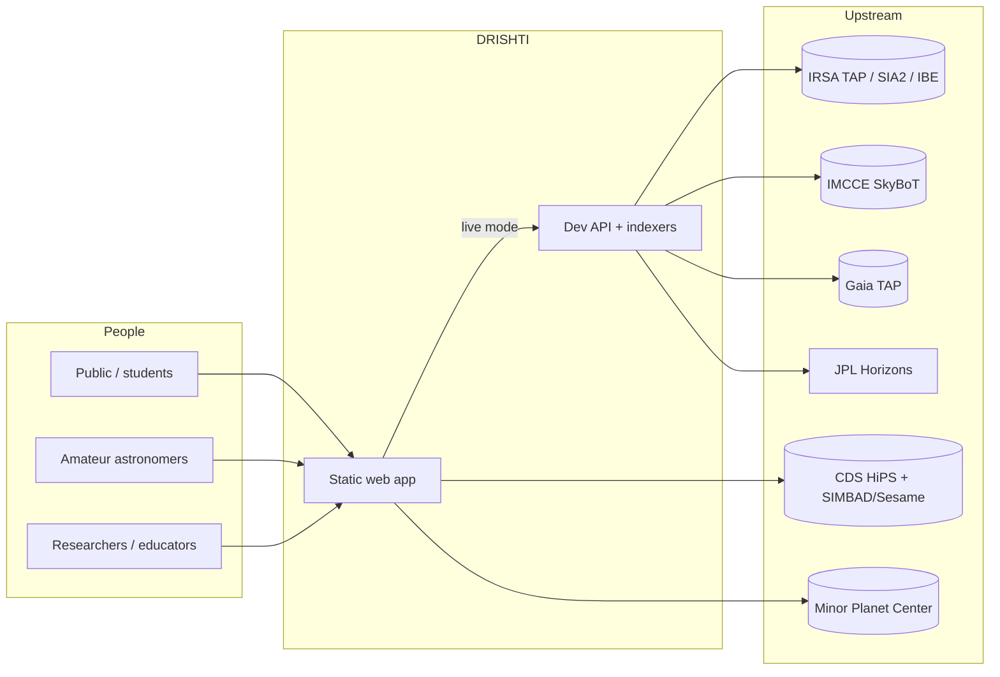
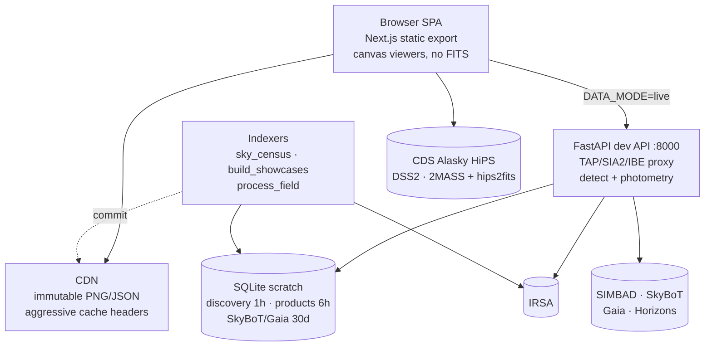
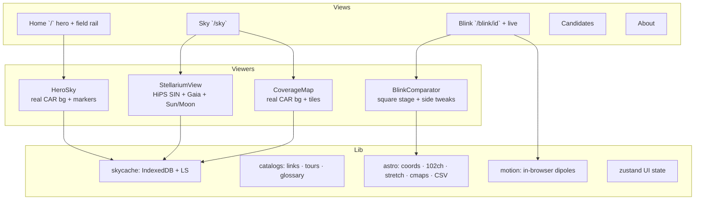

# DRISHTI — System Design

Public time-machine for the SPHEREx sky: pick any patch of sky, blink its
repeated visits, spot what moved. No login. Every pixel traces to IRSA.

This doc is the whole design: context → containers → components → data →
runtime → failure modes → decisions → roadmap. `ARCHITECTURE.md` keeps the
short layer contract; this file explains *why* the system looks this way.

## 1. Context (C4 L1)



Constraints that shape everything:

| # | Constraint | Consequence |
|---|---|---|
| C1 | Production hosting is static-only (CDN, no server) | All science data must be pre-baked into the bundle; live IRSA exists only in dev/live mode |
| C2 | SPHEREx LVF: wavelength varies across each detector | Blink **same-band epochs only** (`|Δλ| < ½ bandwidth`), enforced in `cutouts.wavelengths_match` |
| C3 | Full-frame FITS are ~100s of MB | Browser never touches FITS; only ≤100 KB rendered PNG cutouts |
| C4 | IRSA TAP is slow (20–120 s/query) and rate-limited | Aggressive caching at every layer; bounded daemon-thread queries; resumable indexers |
| C5 | No login, no personal data | Community flags live in `localStorage`, never leave the device |
| C6 | First meaningful view < 3 s, frame switch < 200 ms | Static bundle + preloaded frames + device-side tile cache |

## 2. Containers (C4 L2)



Two runtimes, one contract:

- **Static bundle** (`spectrahunt-web/out/`): the product. Works offline, works on a phone, serves in < 3 s. All JSON/PNG committed to `public/`.
- **Dev/live layer** (FastAPI + scripts): never on the CDN. Proxies IRSA (CORS + rate limits), renders cutouts, runs detection/photometry, fills the bundle on a weekly/manual cadence (`.github/workflows/refresh.yml`).

## 3. Frontend components (C4 L3)



Key components:

- **StellariumView** — ground-observer POV: HiPS `hips2fits` SIN JPEG for the exact
  view (center/FOV/survey), gnomonic overlay math (grid, 88 constellation figures,
  Gaia DR3 stars sized by G mag, computed Sun + Moon-with-phase), Alt/Az from
  device-or-default location + live clock, drag-look / wheel-zoom / click-inspect.
  Orientation verified against real frames (FITS E-left; overlays un-mirrored).
- **BlinkComparator** — canvas engine: blink / side-by-side / swipe-curtain /
  true B−A difference with gain, motion-color composite (R=B,G=A,B=|diff|),
  stretch (linear/log/sqrt/asinh) + black/white + presets + invert, colormaps
  (cividis default = colorblind-safe), 6 detectors × 102 LVF channels + RGB picker,
  click-to-sample spectrum, PNG/WebM export, preloaded frames, keyboard transport.
- **CoverageMap / HeroSky** — shared verified 2MASS CAR all-sky background
  (log stretch, RA-left ⇒ mirrored on draw so overlay math stays RA-right),
  TAP-measured epoch tiles, clickable blink-field markers on the hero.
- **SearchBox** — showcases + decimal/sexagesimal coords + 88 constellations +
  SIMBAD-ASCII-first name resolve with Sesame fallback + Surprise dice.

## 4. Data design

### 4.1 Layer contract (the one rule)

```
IRSA TAP / SIA2 / IBE / S3            ← L0 origin, source of truth
  │  (+ Gaia TAP, SIMBAD, SkyBoT, Horizons, Alasky HiPS)
  ├─ scripts (manual/weekly, bounded, resumable, offline-safe)
  │    TAP discover → IBE cutout → mask → zscale PNG
  │    obscore boxes → per-cell tallies (images/epochs/bands/span)
  │         │  promote (budget-gated, <10MB)
  ├─ public/ bundle (showcases/*.json, cutouts/*.png, coverage.json)
  │         │  (static export reads ONLY this)
  └─ browser (+ IndexedDB tile cache, localStorage flags/tutorial)
```

### 4.2 Contracts

- `showcases/{id}.json`: `{id,title,ra,dec,story,epochs[{label,obs_id?,band?,
  wavelength_um?,mjd?,ra?,dec?,png?,cutout_url?,note?}],tap,links,citation}`.
  `png:null` is valid (renders metadata + "cutout pending").
- `coverage.json`: `{grid:{w:72,h:36},cells:{"i,j":{showcase,ra,dec,images,
  images_capped,epochs,bands,span_mjd,per_band}},generated_at,source}`.
  Passes split on >20 d gaps; deep fields read as continuous stare.
- `cutouts/*.png`: ≤100 KB, zscale+asinh, immutable cache headers.
- Live API shapes: `/api/frames` → epoch list with per-epoch render URLs;
  `/api/detect` → dipole candidates + Gaia/SkyBoT labels; `/api/lightcurve`,
  `/api/spectrum` → aperture-photometry points; `/api/stars` → Gaia cone.

### 4.3 Provenance & honesty

- Every number carries its source: showcase JSON keeps `cutout_url` (original
  IRSA FITS), `obs_id`, MJD; UI links originals; QR2 DOI on every page/export.
- Never fabricated: missing data renders as missing (pending tiles, dark cells,
  "not yet surveyed", graceful `detail` strings like `need-2-epochs`).
- Same-band rule enforced at index time AND at blink time (band-labeled epochs).

## 5. Backend pipeline (dev/live)

```mermaid
flowchart LR
    POS[ra, dec, band] --> DISC[TAP discover<br/>cached 1h]
    DISC --> FETCH[IBE FITS fetch]
    FETCH --> PARSE[parse IMAGE/FLAGS/VARIANCE/WCS]
    PARSE --> MASK[mask bad px<br/>median fill]
    MASK --> ALIGN[WCS reproject B→A<br/>corr-shift fallback]
    ALIGN --> DIFF[significance B−A<br/>variance or MAD noise]
    DIFF --> DIPOLE[+/- peak pairing<br/>movers vs variables]
    DIPOLE --> PHOT[aperture photometry<br/>both epochs]
    PHOT --> LABEL[Gaia 8in star?<br/>SkyBoT mover?]
    LABEL --> OUT[candidates + lightcurve + spectrum]
```



- `epochs.py` — TAP-first (daemon-thread bound, never wedges), SIA2 fallback, never raises.
- `cutouts.py` — lazy astropy; bad-pixel mask per Explanatory Supplement bits.
- `align.py` — `reproject_interp` on celestial WCS; FFT phase-correlation fallback.
- `photometry.py` — aperture + annulus background, variance-aware errors;
  significance map; dipole pairing (mover = adjacent +/− pair, else variable).
- `crossmatch.py` — SkyBoT (SQLite-cached), SIMBAD-ASCII-first resolve + Sesame
  fallback, Horizons on demand, Gaia DR3 cone + per-view cone (30 d cache).
- `pipeline.py` — orchestration + TTL caches (discovery 1 h, products 6 h).
- `detect.py` — legacy fast path (SEP→photutils→scipy→numpy peak finder).
- `scripts/process_field.py` — one position → full JSON report (batch use).
- `scripts/sky_census.py` — 4-shard all-sky obscore census (resumable, mergable).
- `scripts/build_showcases.py` — oldest+newest same-spot pairing → PNGs.
- Every endpoint degrades gracefully (404/`[]`/`detail` — never 500).

## 6. Caching & performance

| Layer | What | TTL / policy |
|---|---|---|
| CDN | PNG/JSON bundle, `_next/static` | immutable / 1 h–1 y |
| Browser HTTP cache | HiPS JPEGs, Allsky CAR | upstream headers |
| IndexedDB `spectrahunt-sky` | HiPS view tiles (≤4 MB each), neighbor prefetch on idle | LRU, quota-safe |
| localStorage | constellation lines, per-view Gaia stars (20-view LRU), flags, tutorial | pinned / LRU |
| SQLite `api_cache` | TAP discovery 1 h; lightcurve/spectrum 6 h; Gaia/SkyBoT 30 d | TTL-checked reads |
| In-memory | preloaded blink frames (`Image` objects) | per-view lifetime |

Frame switching < 200 ms after preload; first view < 3 s (static shell + cached tiles).

## 7. Coordinate consistency (verified, not assumed)

A past bug class: background imagery disagreed with overlay math. Closed by
measurement (real IRSA/CDS frames inspected pixel-level — see
`docs/assets/orion-sin.jpg` and `docs/assets/full-2mass-log.jpg`):

| Surface | Truth | Handling |
|---|---|---|
| HiPS Allsky.jpg | HEALPix tile **mosaic**, not equirect | **never used as a map** |
| hips2fits CAR full-sky | true equirect, **RA increases LEFT**, log stretch needed | hero + all-sky map draw **mirrored X**; overlay math unchanged (RA-right) |
| hips2fits SIN tiles | FITS-standard (N up, E left), correctly centered (Orion/M42 check) | observer overlays use **mirrored gnomonic** (`sx = cx − x·scale`), inverse + drag signs flipped to match |
| Coverage grid | 72×36, RA-right | identical `cellOf` in map, hero, inspector |

Cross-view invariant: same (RA, Dec) → same census cell → same inspector →
same blink, in every projection.

## 8. Failure modes

| Failure | Behavior |
|---|---|
| IRSA slow/down | bounded waits; cached discovery serves; UI shows pending states; static bundle unaffected |
| Single box/frame fails | skipped, logged; census resumes; indexer leaves `png:null` |
| Name unresolvable | honest "did not resolve" + coordinate/constellation hints |
| < 2 epochs at a point | `need-2-epochs`; inspector explains; curated blinks offered |
| GPU/canvas unavailable | static fallbacks; semantic HTML content still readable |
| `prefers-reduced-motion` | all autoplay/twinkle frozen; transport stays manual |

## 9. Deployment & operations

- Static export (`next build` → `out/`) on any CDN; `netlify.toml` pins build,
  security headers, immutable-asset caching. No server, no secrets, no DB.
- Weekly refresh: `refresh.yml` reruns census + indexer → rebuild → push.
- Overnight pattern used in development: `scripts/nightly.sh` loop
  (merge → fill → build → verify → commit) while shard workers measure the sky.
- Observability: structured stdout logs per worker (`/tmp/opencode/spectrahunt-logs/`
  locally); verify scripts assert cells/PNGs/API counts each pass.
- Cost: ~$0 infra (CDN free tier + public archives); bounded IRSA load via
  caches, TOP caps, and off-peak batching.

## 10. Decisions (short ADRs)

1. **Aladin-free custom canvas** — full control of blink/diff compositing and
   zero heavy deps; HiPS used as raw imagery instead.
2. **Static-first, live-second** — guarantees the demo/offline story; live mode
   is a strict superset behind `DATA_MODE`.
3. **Same-spot oldest+newest pairing** for showcases — maximizes visible change
   per blink with minimum bytes.
4. **Dipoles, not just detections** — a mover must explain both its arrival
   (bright) and departure (dark); halves false positives vs. peak-finding.
5. **SQLite scratch, never shipped** — caches are an operational detail;
   the bundle is the product.
6. **Multipage real routes** — shareable, indexable, back-button-correct;
   permalinks encode showcase/band/epoch/mode.
7. **Dead upstreams get breakers, not retries forever** — IMCCE retired the
   legacy SkyBoT cone endpoint mid-project; after verification the client got
   a consecutive-failure circuit breaker (24 h) plus honest UI copy, instead
   of slow-failing on every view. Same policy applies to future retirements.

## 11. Roadmap

- M4: ecliptic census densification → real surveyed belt; per-band PNG rows;
  planet positions (Horizons batch) + day/night terminator in observer view.
- M5: weekly Action live; convergence meter (`x/2592 cells surveyed`, itself real);
  community flag aggregation (opt-in, anonymized); multi-language UI.
- Later: WISE/2MASS/Pan-STARRS side panel via HiPS; 3D Sun–Earth–object geometry;
  on-device (WASM) source extraction for instant live diffs.
